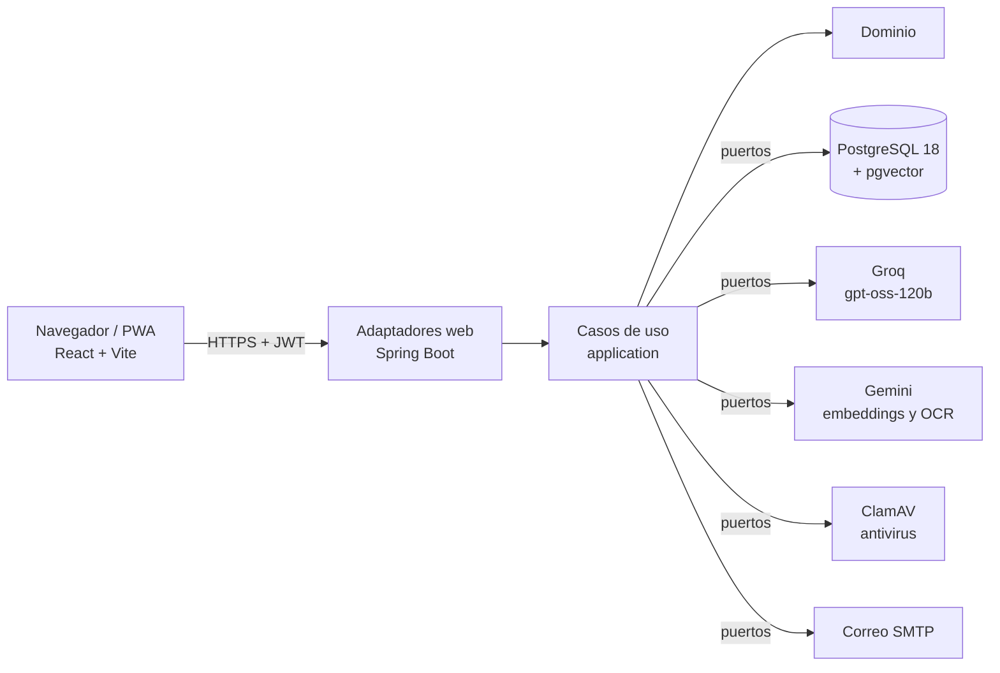

# Iris

**Pregúntale a Iris.** Asistente con inteligencia artificial para organizadores de eventos. Iris lee los documentos de un evento (contratos, cronogramas, reglamentos), responde preguntas citando siempre el documento y la página de donde sacó cada dato, y propone tareas y sesiones para la agenda. Nada entra a la agenda sin el visto bueno de una persona, e Iris nunca oculta que es una IA.

Proyecto del curso de Inteligencia Artificial de Campuslands (Bucaramanga, 2026), construido sobre la arquitectura RAG de referencia del curso: Java, Spring Boot y pgvector.

---

## Contenido

1. [Qué hace](#qué-hace)
2. [Arquitectura](#arquitectura)
3. [Cumplimiento de los requerimientos](#cumplimiento-de-los-requerimientos)
4. [Seguridad](#seguridad)
5. [Requisitos previos](#requisitos-previos)
6. [Puesta en marcha](#puesta-en-marcha)
7. [Variables de entorno](#variables-de-entorno)
8. [Pruebas](#pruebas)
9. [API](#api)
10. [Estructura del repositorio](#estructura-del-repositorio)
11. [Limitaciones conocidas](#limitaciones-conocidas)
12. [Flujo de trabajo con Git](#flujo-de-trabajo-con-git)

---

## Qué hace

| Funcionalidad | Descripción |
|---|---|
| Eventos con equipo | Cada evento es un espacio aislado (multi-tenant). Roles por evento: propietario, editor y lector. Invitaciones por correo con vencimiento de 7 días. |
| Documentos | Carga de PDF con validación, antivirus y OCR para páginas escaneadas. El PDF original **no** se conserva en el servidor: solo fragmentos, vectores y metadatos. |
| Pregúntale a Iris | Chat con respuestas en vivo (streaming). Cada afirmación lleva su cita `[n]` con documento, página y sección. Si los documentos no lo dicen, Iris lo advierte en lugar de inventar. |
| Propuestas de Iris | Al terminar de indexar un documento, Iris propone tareas y sesiones, cada una con la frase textual que la justifica. Se aceptan, se ajustan o se descartan. No repite lo que ya existe en el evento (comparación por significado con embeddings) ni lo que el equipo descartó. |
| Agenda y tareas | Sesiones por tipo (conferencia, taller, panel...) y tareas con responsable y fecha límite. |
| Notificaciones | Campanita en la app y correo (Mailpit en desarrollo). Recordatorio diario de tareas que vencen, sin avisos duplicados. |
| App instalable | PWA: se instala desde Chrome o Edge y abre en su propia ventana. Diseño adaptable a escritorio, tableta y celular, con modo claro y oscuro. |

---

## Arquitectura

Backend en **arquitectura hexagonal** (puertos y adaptadores), dividido en tres módulos de Maven:

```
backend/
├── domain/          Reglas de negocio en Java puro (sin Spring): eventos, documentos, propuestas...
├── application/     Casos de uso y PUERTOS (interfaces) hacia el exterior. Java puro.
└── infrastructure/  ADAPTADORES: Spring Boot, web, PostgreSQL, Groq, Gemini, ClamAV, PDFBox, correo.
```

El dominio y la aplicación no dependen de ningún framework: cambiar de proveedor de IA, de antivirus o de base de datos significa escribir un adaptador nuevo, sin tocar las reglas de negocio.



### Tecnologías

| Capa | Tecnología |
|---|---|
| Backend | Java 21, Spring Boot 4.1.2, Spring AI 2.0.1, Spring Security (JWT HS256), Flyway |
| Base de datos | PostgreSQL 18 + pgvector 0.8.2 (Docker) |
| IA | Groq `openai/gpt-oss-120b` (respuestas y propuestas), Gemini `gemini-embedding-001` a 1536 dimensiones (embeddings), Gemini Flash-Lite con respaldo en Gemini Flash (OCR) |
| Documentos | Apache PDFBox 3.0.8 (texto, estructura y renderizado para OCR) |
| Seguridad de archivos | ClamAV 1.5 (Docker) + validación de estructura del PDF |
| Frontend | React 19, React Router 8, Vite 8, vite-plugin-pwa 2, CSS propio con variables (sin librerías de componentes) |
| Correo de pruebas | Mailpit |

### Flujo de indexación

1. La persona sube un PDF por HTTPS.
2. El servidor revisa el tamaño, lo pasa por el **antivirus** sin abrirlo, verifica que sea un PDF real (bytes `%PDF-`) y **valida su estructura** (rechaza JavaScript, acciones que abren programas y archivos incrustados). Detecta duplicados por huella SHA-256.
3. Se guarda una copia temporal y se responde `202 Accepted`: el resto ocurre en segundo plano.
4. Un trabajo asíncrono extrae el texto página por página con PDFBox. Las páginas sin texto (escaneadas) se convierten en imagen y se leen con **OCR**.
5. El texto se divide en fragmentos de hasta 1000 tokens con 120 de solapamiento, conservando página, sección y orden.
6. Se genera un embedding por fragmento y se guarda en PostgreSQL junto con el texto, el evento, el modelo y los metadatos.
7. Se verifica que todo quedó guardado y **solo entonces** se elimina la copia temporal del PDF.
8. Iris lee el documento y propone tareas y sesiones.

### Flujo de consulta

1. Se genera el embedding de la pregunta con el **mismo modelo** del índice.
2. Búsqueda **híbrida**: similitud vectorial (pgvector, índice HNSW) y búsqueda de texto completo en español (`tsvector`, índice GIN), siempre filtradas por el evento y los permisos de la persona.
3. Los dos rankings se fusionan con **RRF** (*Reciprocal Rank Fusion*, k = 60) y se eligen los 5 mejores fragmentos.
4. El modelo responde solo con esa evidencia y cita cada dato. Un validador elimina las citas a fragmentos que no se le entregaron.
5. La respuesta llega en vivo por *Server-Sent Events*.

---

## Cumplimiento de los requerimientos

| Requerimiento | Implementación |
|---|---|
| PDF original en el equipo del cliente; en el servidor, fragmentos, vectores y metadatos | La copia temporal se borra tras verificar la indexación (`ProcesarDocumento`, paso 7) |
| Carga por HTTPS | Backend (SSL bundle PEM de Spring Boot) y frontend (Vite) por HTTPS con certificados de mkcert |
| Límites de tamaño, validación y escaneo de archivos | Tope de 20 MB, firma `%PDF-`, validación de estructura (`InspectorPdfBox`) y antivirus ClamAV (`AntivirusClamAv`) |
| Procesamiento asíncrono | Cola con `@Async` y un hilo dedicado de indexación |
| OCR para páginas escaneadas | `LectorOcrGemini`: solo para las páginas sin texto, conservando su número de página |
| Fragmentos de 500 a 1000 tokens con solapamiento | 1000 tokens con 120 de solapamiento, con página, sección y orden |
| Embeddings y mismo modelo para pregunta e índice | `gemini-embedding-001` (1536 dimensiones); el modelo queda registrado en cada documento |
| PostgreSQL + pgvector con permisos, modelo y metadatos | Esquema versionado con Flyway (12 migraciones) |
| Filtros de tenant y autorización en cada búsqueda | Toda consulta filtra por evento y verifica la membresía de la persona |
| Búsqueda híbrida con reordenamiento | Vectorial + texto completo, fusionadas con RRF |
| Respuestas con citas a documento, página y fuente | Citas `[n]` validadas, con documento, páginas y sección |
| Trazabilidad | Historial de consultas, notificaciones y decisiones sobre propuestas (quién y cuándo) |

---

## Seguridad

- **Autenticación** con JWT (HS256) y contraseñas con BCrypt. El token vive en `sessionStorage` y se borra al cerrar la pestaña.
- **Dos niveles de autorización:** los roles globales (administrador) se validan en `SecurityConfig`; los roles **por evento** (propietario, editor, lector) se validan en el dominio, porque dependen de los datos de cada evento.
- **Multi-tenant:** quien no pertenece a un evento recibe `404`, no `403`, para no revelar que el evento existe.
- **Archivos:** antivirus antes de abrir el PDF (abrir un archivo malicioso ya es un riesgo) y política de **fallar cerrado**: si el antivirus no responde, el archivo no se acepta (`503`).
- **Condiciones de carrera** resueltas en la base de datos: `UPDATE ... WHERE estado = ...` condicionales, índices únicos parciales e `INSERT ... ON CONFLICT DO NOTHING`.
- **Secretos** solo en el archivo `.env`, que Git ignora. El repositorio incluye `.env.example` con valores de ejemplo.
- **IA honesta:** la respuesta solo puede apoyarse en fragmentos del evento, las citas inventadas se eliminan y la interfaz recuerda que Iris es una IA y puede equivocarse.

---

## Requisitos previos

| Herramienta | Versión usada |
|---|---|
| Java (JDK) | 21 |
| Maven | 3.9 o superior |
| Node.js / npm | 24 / 11 |
| Docker Desktop | Con al menos 4 GiB libres para ClamAV, según su documentación oficial |
| mkcert | 1.4.4 (certificados HTTPS locales) |

Claves de API (gratuitas para desarrollo): **Groq** (https://console.groq.com/keys) y **Google AI Studio** para Gemini (https://aistudio.google.com).

---

## Puesta en marcha

### 1. Variables de entorno

```powershell
copy .env.example .env
```

Completa el `.env` con tus claves y contraseñas. Nunca lo subas al repositorio.

### 2. Certificados HTTPS (una sola vez)

```powershell
mkcert -install
mkdir certs
mkcert -cert-file certs/localhost.pem -key-file certs/localhost-key.pem localhost 127.0.0.1 ::1
```

`mkcert -install` crea una autoridad certificadora local en la que confía tu sistema, así el navegador no muestra advertencias. En el `.env`, apunta `TLS_CERTIFICADO` y `TLS_LLAVE` a esos archivos con rutas absolutas (por ejemplo `file:C:/ruta/proyecto-iris/certs/localhost.pem`). La carpeta `certs/` está ignorada por Git: la llave privada es de cada equipo.

### 3. Servicios (PostgreSQL, Mailpit y ClamAV)

```powershell
docker compose up -d
docker logs --tail 15 iris-antivirus
```

La primera vez, ClamAV descarga sus firmas de virus y tarda unos minutos. Está listo cuando el log muestra `Database correctly reloaded`.

### 4. Backend

```powershell
mvn -f backend/pom.xml install -DskipTests
mvn -f backend/pom.xml -pl infrastructure spring-boot:run
```

Flyway crea el esquema al arrancar. La API queda en **https://localhost:8080**.

### 5. Frontend

```powershell
cd frontend
npm install
npm run dev
```

Crea `frontend/.env.development` con `VITE_API_URL=https://localhost:8080` y abre **https://localhost:5173**. Para instalar la app, usa el ícono "Instalar" de la barra de direcciones de Chrome o Edge.

### Puertos

| Servicio | Dirección |
|---|---|
| Frontend | https://localhost:5173 |
| API | https://localhost:8080 |
| PostgreSQL | localhost:5433 (configurable con `DB_PORT`) |
| Mailpit (correos de prueba) | http://localhost:8025 |
| ClamAV | localhost:3310 (solo desde el propio equipo) |

### Datos de demostración

En `demo/pdfs/` hay documentos **ficticios** para probar sin usar información real: un contrato de hotel, un cronograma, un reglamento de expositores y un contrato de sonido **escaneado** (solo imagen, para probar el OCR).

---

## Variables de entorno

| Variable | Obligatoria | Descripción |
|---|---|---|
| `POSTGRES_DB`, `POSTGRES_USER`, `POSTGRES_PASSWORD`, `DB_PORT` | Sí | Base de datos en Docker |
| `JWT_SECRET` | Sí | Clave para firmar los tokens (mínimo 32 caracteres) |
| `GEMINI_API_KEY` | Sí | Embeddings y OCR |
| `GROQ_API_KEY` | Sí | Respuestas del chat y propuestas |
| `TLS_CERTIFICADO`, `TLS_LLAVE` | Sí | Certificado HTTPS y su llave (rutas absolutas con `file:`) |
| `IRIS_ADMIN_EMAIL`, `IRIS_ADMIN_PASSWORD` | No | Crea el primer administrador al arrancar |
| `ANTIVIRUS_HABILITADO` | No | `true` por defecto. Con `false` no se escanea (para equipos con poca RAM) |
| `IRIS_OCR_MODELOS` | No | Modelos de OCR en orden de preferencia, separados por coma |
| `GROQ_MODELO` | No | Otro modelo de Groq |
| `CORREO_HABILITADO` y `MAIL_*` | No | Envío de correos (Mailpit en desarrollo, Gmail con contraseña de aplicación) |
| `CORS_ORIGENES`, `FRONTEND_URL` | No | Por defecto `https://localhost:5173` |

---

## Pruebas

```powershell
mvn -f backend/pom.xml test
```

- **Dominio y aplicación:** pruebas unitarias en Java puro, sin Spring ni base de datos (reglas de invitaciones, propuestas, validador de citas, detector de duplicados, OCR por página).
- **Adaptadores:** el cliente de ClamAV se prueba contra un servidor falso que habla su protocolo; el inspector de PDF, con documentos generados en la prueba.
- `IrisApplicationTests` levanta el contexto completo y necesita Docker encendido.

Frontend: `npm run lint` (oxlint) y `npm run build`.

---

## API

Todas las rutas, salvo registro, inicio de sesión y salud, exigen `Authorization: Bearer <token>`. Los errores siguen el formato *Problem Details* (RFC 9457): `title` y `detail`.

| Recurso | Rutas principales |
|---|---|
| Autenticación | `POST /api/auth/registro`, `POST /api/auth/login`, `GET /api/yo` |
| Eventos | `GET, POST /api/eventos` |
| Equipo | `GET /api/eventos/{id}/miembros`, `PATCH, DELETE .../miembros/{usuarioId}`, `DELETE .../miembros/yo` |
| Invitaciones | `GET, POST, DELETE /api/eventos/{id}/invitaciones`, `GET /api/invitaciones`, `POST /api/invitaciones/{id}/aceptar` o `/rechazar` |
| Documentos | `GET, POST /api/eventos/{id}/documentos` (multipart, campo `archivo`), `DELETE .../documentos/{documentoId}` |
| Consultas | `POST /api/eventos/{id}/consultas`, `POST .../consultas/stream` (SSE), `GET .../consultas` (historial) |
| Búsqueda (depuración) | `GET /api/eventos/{id}/busqueda`, `GET .../busqueda/prompt` |
| Agenda | `GET, POST /api/eventos/{id}/sesiones`, `PUT, DELETE .../sesiones/{sesionId}` |
| Tareas | `GET, POST /api/eventos/{id}/tareas`, `PUT, DELETE .../tareas/{tareaId}`, `PATCH .../tareas/{tareaId}/estado` |
| Propuestas | `POST .../documentos/{documentoId}/revisar`, `GET .../propuestas`, `GET .../propuestas/en-revision`, `POST .../propuestas/{id}/aceptar`, `/descartar` o `/recuperar` |
| Notificaciones | `GET /api/notificaciones`, `GET .../conteo`, `PATCH .../{id}/leida`, `PATCH .../leidas` |
| Administración | `POST /api/admin/recordatorios/ejecutar`, `/api/admin/diagnostico/*` |

---

## Estructura del repositorio

```
proyecto-iris/
├── backend/            API (Maven multimódulo: domain, application, infrastructure)
│   └── infrastructure/src/main/resources/db/migration/   Migraciones Flyway (V1 a V12)
├── frontend/           App web (React + Vite + PWA)
├── demo/pdfs/          Documentos ficticios para la demostración
├── docker-compose.yml  PostgreSQL + pgvector, Mailpit y ClamAV
└── .env.example        Plantilla de configuración (sin secretos)
```

---

## Limitaciones conocidas

- **Sin el PDF original** en el servidor, Iris no puede volver a abrirlo: las citas por página dependen de los metadatos guardados al indexar. Para valor probatorio (firmas, sellos, tablas complejas) el original sigue siendo indispensable, y reindexar exige volver a cargar el PDF.
- **OCR:** hasta 30 páginas escaneadas por documento, y depende de la disponibilidad de Gemini. Si el servicio está saturado, el documento queda en error con un mensaje claro y se puede volver a subir.
- **Planes gratuitos de IA:** los límites por minuto de Groq y Gemini pueden demorar las respuestas en momentos de mucho uso.
- **Una sola instancia:** el bloqueo que evita revisar dos veces el mismo documento vive en memoria. Con varios servidores habría que llevarlo a la base de datos.
- **Certificados de desarrollo:** mkcert es para uso local. En producción se usaría un certificado de una autoridad pública (por ejemplo, Let's Encrypt).

---

## Flujo de trabajo con Git

- **Gitflow:** `main` (entregas), `develop` (integración) y una rama `feature/*` por funcionalidad.
- **Commits** con Conventional Commits y gitmoji: `tipo(ámbito): :emoji: descripción`, por ejemplo `feat(documentos): :mag: leer con ocr de gemini las paginas escaneadas`.

---

## Autor

**Manuel Isaac Camaño Díaz** · Técnico en Desarrollo de Software e Inteligencia Artificial, Campuslands · [GitHub](https://github.com/manuelisaaccamanidiaz-lgtm)
